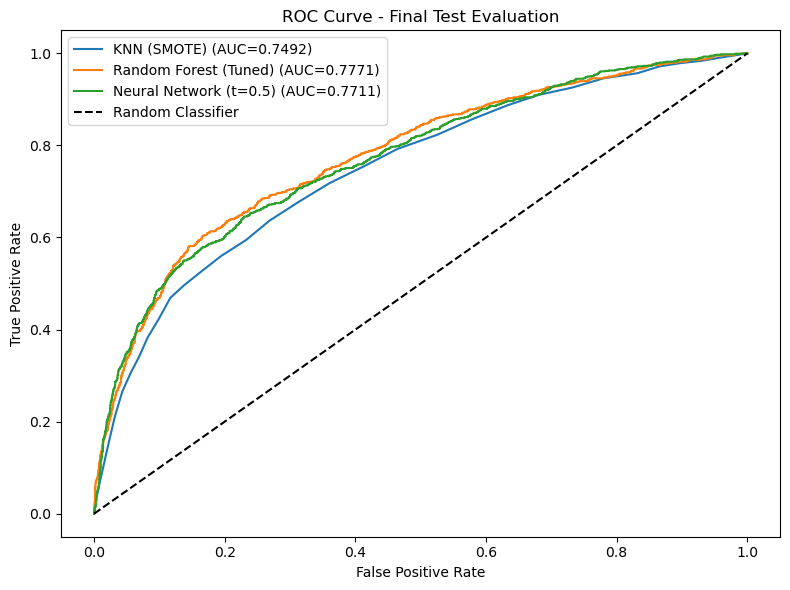

# Credit Card Default Prediction

Predicting which credit card holders will default next month — while keeping false alarms low enough to protect creditworthy customers. Built as a risk-scoring recommendation for **InclusiFinance**, a lender with a financial-inclusion mission.

## 🎯 Problem
About 22% of cardholders default. Missing a default costs money; wrongly flagging a good customer cuts off their access to credit. The goal: an **accurate, explainable, cheap-to-retrain** model that balances both.

## 📊 Data
- [UCI Default of Credit Card Clients](https://archive.ics.uci.edu/dataset/350/default+of+credit+card+clients) — 30,000 Taiwanese accounts
- 6 months of repayment status, bill amounts, and payments (Apr–Sep 2005), plus credit limit and demographics
- Target: default in October 2005 (77.9% / 22.1% split)

## ⚙️ Approach
- Stratified **70 / 15 / 15** train / validation / test split
- Undocumented category codes recoded to `other`; features standardized
- Three models, each handling class imbalance differently:

| Model | Imbalance strategy | Key settings |
|---|---|---|
| KNN | SMOTE oversampling | k = 30, reduced 13-feature set |
| **Random Forest** | `class_weight='balanced'` | 300 trees, depth 10, min leaf 4 — grid search over 108 combos |
| Neural Network | Computed class weights | 64→32 ReLU, 30% dropout, early stopping |

## ✅ Results (held-out test set, n = 4,500)

| Model | AUC-ROC | Default recall | Default precision | F1 |
|---|---|---|---|---|
| **Random Forest** | **0.777** | 58.1% | **52.1%** | **0.549** |
| Neural Network | 0.770 | — | — | 0.532 |
| KNN + SMOTE | 0.749 | **63.6%** | 40.3% | — |

**Recommendation: Random Forest.** Best overall performance, trains in ~2 seconds, and every flag can be traced to specific features. KNN's ~60% false-positive rate would undermine the inclusion mission; the neural net added complexity without a meaningful gain.

**Key finding:** Most recent repayment status (`PAY_0`) dominates, followed by credit limit and earlier payment history. Gender, education, and marital status contribute little — the model scores customers on behavior, not demographics.



## 🚀 Next steps
- Lower the threshold (0.50 → 0.45) to push recall to ~62% for more conservative risk policies
- Monitor AUC, recall, and precision monthly; retrain on in-house outcomes
- Add SHAP explanations for per-customer transparency

## 📁 Repo structure
```
├── data/            # instructions to download the UCI dataset
├── notebooks/       # EDA, modeling, evaluation
├── images/          # ROC curves, feature importance
├── report/          # full write-up (PDF)
├── requirements.txt
└── README.md
```

## ▶️ Run it
```bash
pip install -r requirements.txt
jupyter notebook notebooks/
```
